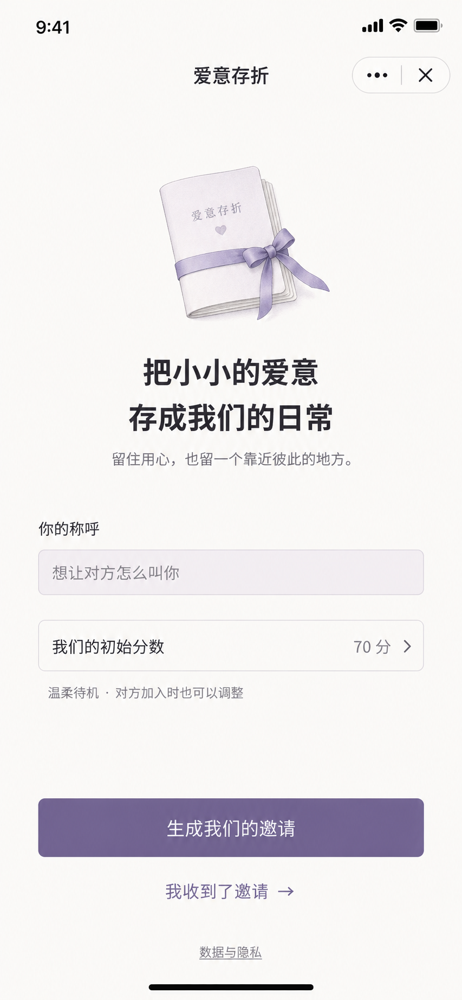
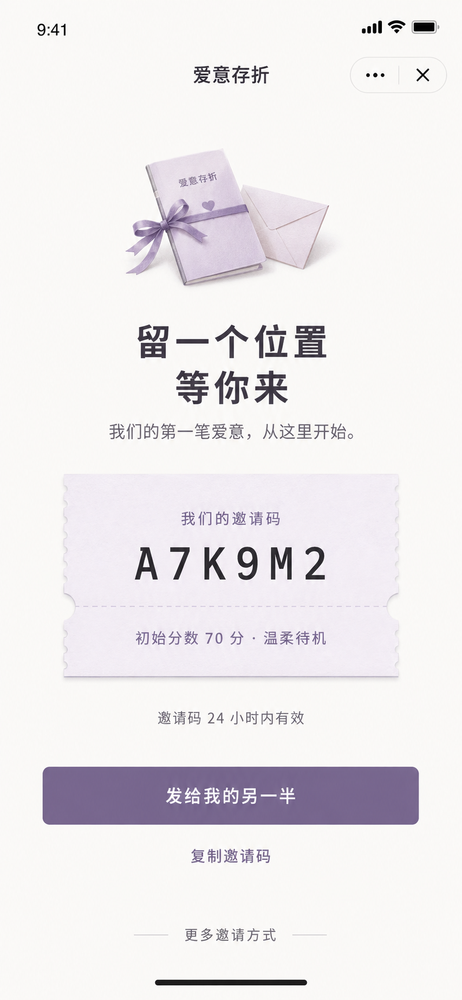
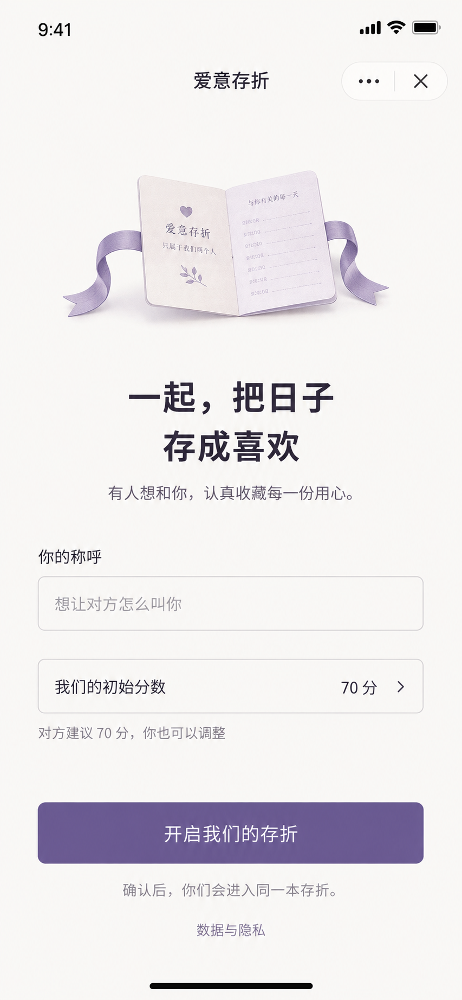

# 爱意存折｜轻量邀请流程设计稿与开发规范

- 版本：v1.0，2026-09-07。
- 状态：待视觉确认的设计稿，不是已经替换的线上页面。
- 范围：未配对入口、创建邀请、邀请已生成、接受邀请、首次隐私确认、失败状态。仅小程序。
- 相关需求：[日常感谢与每周回顾 PRD](../product/positive-moments-prd-v1.md)。
- 原则：一屏一件事，把“填一张长表”变成“留一个位置，邀请对方”。

## 1. 本次删减什么

邀请主页面移除：

- “建立共同空间”的技术性长说明。
- 管理员访问、权限、审计、清理期限等整块正文。
- 创建和接受邀请同时展开的两套表单。
- “读取建议分数”的额外按钮。
- 分享、复制、扫码、重新生成同时争抢注意力的一组按钮。
- 大段安全提示和重复确认卡片。

不删除真正的鉴权、当前隐私版本同意、双人确认、邀请码有效期与一次性约束。邀请首页仅保留“数据与隐私”文字入口；完整说明在独立隐私页，首次提交时才出现单独的简短同意层。

这不是把“点击按钮”偷换为同意：从未同意/版本更新的用户必须主动点击同意层中的明确确认按钮，关闭同意层不会创建邀请或建立配对。

## 2. 页面状态与流程

```text
普通未配对进入 → 创建邀请页
                   ├─ 生成我们的邀请 → 首次必要同意 → 邀请已备好 → 用户主动分享/复制
                   └─ 我收到了邀请 → 输入邀请码 → 自动加载邀请 → 接受邀请页

有效分享/扫码进入 ────────────────────────→ 接受邀请页
                                                     └─ 开启我们的存折
                                                        → 首次必要同意 → 明确确认配对 → 首页

无效/过期/已撤回 → 温和错误态，不显示默认分数让用户盲目接受
已配对用户       → 当前共同空间；其他邀请不自动切换或覆盖现有关系
```

所有页面均为状态，不要求每个状态都新建独立物理路由。正式开发使用明确的状态机，不能靠多个相互冲突的布尔值拼接两套表单。

## 3. 视觉稿

本组采用内置 Image Gen 生成，属于视觉评审稿。图中邀请码与数值均为演示数据，不是可用邀请。实际开发的文案、数值和状态以本规范为准；图片不是可点击的生产界面。

### 3.1 生成邀请



### 3.2 邀请已备好



### 3.3 接受邀请



生成提示词另存为 [图像提示词](./invitation-image-prompts-v1.md)，便于后续按同一方向调整。

## 4. 逐屏精确文案与交互

### A. 生成邀请（默认入口）

| 元素 | 文案/规则 |
|---|---|
| 原生导航 | 爱意存折；保留微信原生右上角胶囊，不伪造系统可交互控件 |
| 小插画 | 小本子与低饱和丝带，约 120×110 逻辑像素，不用钞票、银行卡、太阳或大红爱心 |
| 主标题 | 把小小的爱意 / 存成我们的日常 |
| 副文案 | 留住用心，也留一个靠近彼此的地方。 |
| 称呼 | 标签“你的称呼”；占位“想让对方怎么叫你” |
| 初始分数 | 一行“我们的初始分数　70 分 ›”，整行可点击修改 |
| 分数说明 | “温柔待机 · 对方加入时也可以调整”；分段词随实际分数变化 |
| 主按钮 | 生成我们的邀请 |
| 次入口 | 我收到了邀请 → |
| 页脚 | 数据与隐私 |

- 首次没有有效称呼时留空，不填“未命名的伴侣”；有当前已保存称呼则预填。
- 称呼沿用 2–20 字校验；输入错误显示在字段附近，不让用户只看到一个无解释的灰按钮。
- 初始分数默认 70，点击展开底部编辑层：数字键盘、0–100 范围、动态分段词、按钮“就从这里开始”。不展开六个分段的长介绍。
- 分数清空时为未填写，不得经 Number('') 误变成 0；暂存修改只有点确认才替换原值，关闭层不丢原值。
- 主按钮点击先本地校验，再按是否需要同意进入 F 状态；网络请求期间显示“正在准备邀请…”并阻止重复提交。
- 不自动复制邀请码。成功进入 B，让用户自己选择分享还是复制。
- 普通未配对首页直接承接该设计，避免先出现一个“建立共同空间”中转页面又点一次。

### B. 邀请已备好

| 元素 | 文案/规则 |
|---|---|
| 主标题 | 留一个位置 / 等你来 |
| 副文案 | 我们的第一笔爱意，从这里开始。 |
| 邀请纸条 | 标签“我们的邀请码”；大号等宽码；“初始分数 70 分 · 温柔待机” |
| 到期说明 | 邀请码 24 小时内有效；实际实现同时可见准确“有效至 M月D日 HH:mm” |
| 主按钮 | 发给我的另一半 |
| 次按钮 | 复制邀请码 |
| 更多 | 更多邀请方式 |

- “发给我的另一半”调用用户主动触发的微信分享；取消分享不声称已经发出，仍保留当前邀请。
- 分享卡片标题：`想和你，把日子存成喜欢。`；路径只带必要的短期邀请码，不带称呼、手机号、双方关系正文或分数历史。
- “更多邀请方式”底部菜单放“生成小程序码”“作废并重新邀请”“撤回邀请”。重新生成必须提示旧邀请会失效并经用户确认，不能每次回来自动换码。
- 页面显示等待状态，不主动推断对方是否看过邀请。用户回到前台或主动刷新时检查配对结果，成功后进入共同首页；不新增高频轮询。
- 当前数据库保存 codeHash，不能从 hash 反推出旧邀请码。开发需保留创建者本机的短期邀请结果，用环境＋用户隔离，TTL 不超过服务端 expiresAt；只用于原账号恢复待发送邀请。被接受、撤回、过期、退出或账号切换后清除。禁止写入日志/埋点。
- 另一台设备无法恢复明文码时，只提供“原设备发送，或作废后重新邀请”，不能伪造可恢复能力。服务端校验有效状态后再显示本机缓存。
- 即使创建已成功、复制/分享失败，邀请也仍有效；应提示“邀请已备好，可再试一次分享”，不能重新创建。

### C. 输入邀请码（只在手动进入时）

- 标题：`接住这份邀请`。
- 单个邀请码输入框：`输入对方发来的邀请码`，按钮：`看看这份邀请`。
- 允许用户主动粘贴；不自动读取系统剪贴板，不请求通讯录/位置/手机号。
- 不展示称呼和初始分数，直到成功取得邀请预览。
- 从有效微信分享路径进入时跳过本页，自动预览后进入 D。

### D. 接受邀请

| 元素 | 文案/规则 |
|---|---|
| 主标题 | 一起，把日子 / 存成喜欢 |
| 副文案 | 有人想和你，认真收藏每一份用心。 |
| 称呼 | 与创建页相同 |
| 初始分数 | 与创建页同样的编辑行，但初始值来自本次有效邀请，不写死 70 |
| 说明 | 对方建议 70 分，你也可以调整 |
| 主按钮 | 开启我们的存折 |
| 底部说明 | 确认后，你们会进入同一本存折。 |
| 页脚 | 数据与隐私 |

- 邀请预览未成功时禁止接受；数字占位显示“读取中”，不能以本地默认 70 放行。
- 用户改动为 65 后说明保持“对方建议 70 分，你也可以调整”，行内显示 65；最终提交为 65。
- 预览加载期间换码/返回时必须废弃旧请求结果，不能将 A 邀请分数填给 B 邀请。
- 同意后仍需显式接受动作；扫码和打开卡片本身不自动配对。
- 配对写入成功但刷新失败，提示“已经配对成功，正在同步你们的存折”，后续重试读取结果，不再次接受旧邀请码。
- 与现有创建者已加入其他空间、邀请码被消费或接受响应丢失的事务/幂等规则保持一致，不为精简页面弱化服务端验证。

### E. 已配对与失效状态

| 状态 | 展示与行动 |
|---|---|
| 已在当前共同空间 | 直接进入首页，打开旧邀请不会报“你无法使用产品” |
| 已配对又打开他人邀请 | “你已经有一本共同存折了”，主按钮“回到我们的存折”；不自动退出 |
| 邀请过期/撤回 | “这份邀请暂时用不了了”，说明“请对方重新发一份邀请给你。”；按钮“输入新的邀请码” |
| 网络异常 | “刚刚没连上，稍等一下再试试。”；保留输入，有“重试” |
| 自己接受自己邀请 | “这是你准备的邀请，发给对方就好。”；返回 B 或普通入口 |
| 频控 | “刚刚尝试得有点频繁，稍后再来。”；不向普通用户展示数据库异常 |
| 删除申请中 | 保留原删除状态页与隐私入口，不恢复创建/接受功能 |

错误详情、集合名和完整调用栈不显示在 UI；记录安全的关联错误编号帮助排查，但不记录邀请码或亲密正文。

### F. 首次必要同意（独立底部层，不占邀请首页）

只在“生成我们的邀请”或“开启我们的存折”被点击、字段校验通过且当前隐私版本未同意时出现。

```text
开始前，确认一件小事

配对后，你们提交的内容会彼此分享。
数据如何保存、导出和删除，请看《隐私说明》。

[ 同意并生成邀请 ]    或    [ 同意并开启存折 ]
        先看看
```

- 没有默认勾选，不使用“继续即同意”；按主按钮才提交当前版本同意。
- 《隐私说明》可点击打开实际完整材料；其中仍需如实解释运营访问、处理方、保存/删除及反馈渠道。
- “先看看”、返回、点击关闭均不提交同意、不执行创建/接受；保留尚未发送的表单。
- 返回页面保留 pendingIntent，但只能在用户明确确认后执行；不得由页面恢复事件重复执行。
- 当前版本已明确同意的用户不重复弹同意层。微信平台自身要求的隐私确认若出现，仍按平台流程完成，不能通过自定义层替代平台状态。
- 未确认前不向内容安全接口提交表单称呼等文本；正常启动所需的已有身份流程与表单发送分开。

## 5. 视觉规范

| 项目 | 设计值 |
|---|---|
| 基准画板 | 390×844 逻辑像素；微信状态栏、导航与安全区使用设备实际值 |
| 页面背景 | #FAF9F6，暖近白，不用黄色旧纸纹 |
| 主色 | #716287，低饱和雾紫；只用于主操作及少量重点 |
| 轻底色 / 分隔线 | #EFEBF3 / #E4E0E8 |
| 主文字 / 次文字 | #34313C / #777180；实际开发复核正文至少 4.5:1 对比度 |
| 字体 | 微信可用中文系统无衬线；不依赖下载字体或图片文字 |
| 标题 | 26 / 38，semibold；正文 14 / 22；按钮 16 / 24；次文案不小于 12 |
| 页边距 | 默认 28；320 宽时 20；行间距采用 8/12/16/24/32 |
| 输入 / 主按钮 | 高 52，圆角 14；触摸目标至少 44×44 |
| 图片 | 单个小本子插画，不超过 140 逻辑像素高；重要表单不能被插画挤出首屏 |
| 动效 | 非必要；若有入场淡入 150–200ms，尊重减少动态设置，无循环爱心、粒子 |
| 控件 | 数字行、文本输入、按钮、底部层为真实组件，不将整张设计图当界面 |

小屏、系统大字体与键盘弹起时允许自然滚动，不能通过缩小字体强行塞满一屏。主按钮位于文档流，键盘出现时输入区域及提交按钮可滚动到达；安全区不得盖住文字。“数据与隐私”低视觉权重，但必须可读、可点。

图像只是候选视觉方向，用户确认前不批量替换全站配色、旧图标或导航。图中存在的色彩/字形生成偏差，以本文精确 token 和文案为开发基准；上线后真实界面须再次截图核对。

## 6. 开发模块与数据变更

1. 邀请页状态机：创建、同意、已生成、输入码、预览、接受、失效/失败、成功。
2. 共用表单与分数底部层：创建/接受复用；空值与请求竞态明确处理。
3. 邀请预览及本机短期恢复：只使用当前有效邀请；码只能经用户选择进入分享/剪贴板。
4. 同意协调器：当前版本、pendingIntent、取消、失败重试；兼容已有隐私接口，顺序不倒置。
5. 视觉组件：小本子插画、邀请纸条、按钮、输入、底部层；适配现有 Taro 技术栈。

无需增加业务数据库集合，不需重新签发所有现有邀请。若为状态恢复新增服务端查询，只返回当前身份有权查看的邀请元信息，不返回他人身份或原始 token；已有 hash 存储不改成可公开读取的明文码。

## 7. 验收清单

- [ ] 普通首次进入只有创建邀请主表单，没有接受邀请长表单、权限正文和多块提醒。
- [ ] 创建页从称呼到主按钮在 390×844 默认字号下可顺畅看到，小屏/大字体可滚动。
- [ ] “数据与隐私”随时可打开，首次真正发送前有显式当前版本同意，取消不落库。
- [ ] 创建者设 60，受邀者预览即显示 60；主动改为 65 后双方初始分数为 65。
- [ ] 未成功加载预览不能以默认值接受；空数字不被当成 0。
- [ ] 不自动读剪贴板、不自动复制、不自动调分享、不索取额外系统权限。
- [ ] 邀请创建成功后，复制失败、分享取消或刷新失败都不额外生成新邀请。
- [ ] 同一账号原设备回来能恢复仍有效邀请；跨账号/过期/已接受/撤回不显示旧码。
- [ ] A/B 邀请请求乱序返回不会串码或串分数。
- [ ] 自己接受、他人已配对、创建者已配对、重复接受和丢包重试均有正确业务结果。
- [ ] 切后台回来、打开旧分享、当前已配对都不会错误回到无法进入产品的死路。
- [ ] 运行状态正确反馈，错误不暴露云端堆栈；现有隐私/删除访问门禁不退化。
- [ ] 视觉无鲜红/亮金、大面积粉色、无关卡片、默认营销标签；文案按本规范。
- [ ] 后续实现完成时需浏览器预览与微信真机截图验证；当前设计图片不能代替此验收。

## 8. 视觉稿检查记录

已逐张打开项目内三张 PNG，检查主标题、主按钮、称呼/分数字段、层级留白、低饱和配色、底部入口与完整画面：核心文案清晰，创建/接受表单不再同屏堆叠，未放置权限长文或警告卡片。

生成图片与正式实现的明确边界：系统栏与胶囊只是示意，开发使用微信原生导航；插画内部的小字、装饰刻度不作为真实数据，正式插画只保留品牌/空白装饰；按钮按纯色 token 实现，不继承生成图片的轻微纹理。B 图仅画了“24 小时内有效”，开发补充服务端准确到期时间。以上不是对已经实现页面的验收记录。

本轮没有可交互页面，因此未运行浏览器/真机 UI 验收；也没有声称像素级还原已经完成。视觉方向确认后，正式开发需单独提取插画资产，构建真实控件，再按第 7 节验收。

## 9. 本轮交付边界

这次只交付规范与三张视觉稿，不修改业务源码、不部署 CloudBase、不重置体验数据。下一步先确认视觉方向，再据此改邀请流程；感谢与每周回顾按独立 PRD 分阶段实现。
