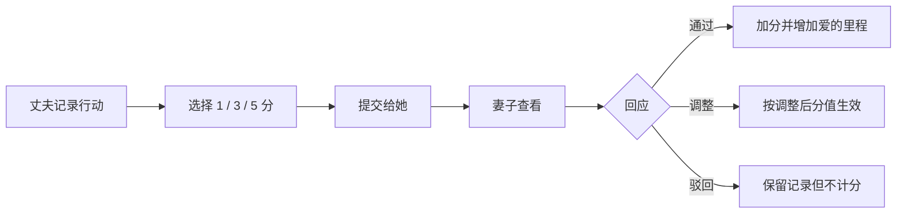
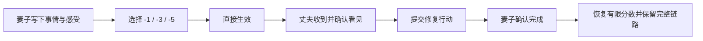

# 爱意加油站：前端产品需求文档

> 版本：v0.1 · 2026-08-18  
> 阶段：高保真原型完成，后端与真实账号系统待接入  
> 产品定位：只属于两个人的行动与修复空间

## 1. 产品结论

“爱意加油站”不是一套用积分购买原谅的奖惩系统，也不评判一个人值不值得被爱。它把关系中容易消失的好意、没有被看见的感受和需要兑现的修复行动，变成双方都能确认的轻量记录。

首版采用微信内可直接打开的移动 H5。丈夫提交正向行动，妻子通过、调分或驳回；妻子记录负向事件后直接扣分，无需丈夫审批；丈夫可以确认收到并发起修复。系统同时维护“最近30天的爱意温度”和“只增不减的爱的里程”。

### 1.1 成功标准

- 从微信打开到完成一次提交不超过 45 秒。
- 妻子完成一次通过或直接记录不舒服不超过 30 秒。
- 所有分数变动都可追溯到一条具体事件，没有无来源改分。
- 低分提醒提供具体修复动作，不制造羞辱、威胁或公开比较。
- 双方在首次使用前共同确认规则，任何一方可以暂停使用。

### 1.2 明确不做

- 不做公开排行榜、连续签到、勋章竞争或“别人家的伴侣”对比。
- 不用积分兑换原谅、亲密行为、家务豁免或情绪劳动。
- 不用 AI 判断谁对谁错，不分析聊天记录，不监听微信。
- 不用高频推送催促妻子审批，不把她变成产品管理员。
- 不允许任何一方静默删除、篡改已经生效的事件。

## 2. 用户、角色与权限

一个“加油站”严格绑定两个账号。双方看到同一本账，但操作权限不同。

| 能力 | 丈夫端 | 妻子端 |
|---|---:|---:|
| 提交正向行动 | 是 | 可选，可直接奖励 |
| 审批丈夫提交 | 否 | 通过 / 调分 / 驳回 |
| 记录负向事件 | 查看与确认 | 直接生效 |
| 撤销已生效记录 | 否 | 否，改用更正记录 |
| 提交修复行动 | 是 | 可主动建议 |
| 确认修复完成 | 否 | 是 |
| 暂停计分 | 可发起 | 可发起，任一方发起即暂停 |
| 导出或销毁共同数据 | 双方确认 | 双方确认 |

生产账号采用“一次性邀请链接 + 配对确认”。链接在使用后失效；一个账号只能加入一个加油站。首次配对页必须展示产品边界，并要求双方分别确认“积分不等于原谅”和“任何一方都可暂停”。双方确认后进入“由她设定初始温度”步骤，只有女方账号可以提交这个起始值。

## 3. 核心计分模型

### 3.1 两个数

1. **爱意温度（0～100）**：最近30天的关系行动温度。新站没有系统预设初始值，必须由女方在初始化步骤从0～100中选择；界面仅将70作为可调整的建议值。
2. **爱的里程**：累计被确认的正向行动次数，只增不减，不参与告警。
3. **历史账本**：事件永久保留，不会因为超过30天计分窗口而删除；账本默认展示近1月，并可切换近3月或全部历史。

正式计算口径：

```text
爱意温度 = clamp(女方设定的初始值 + 最近30天已通过正向分 + 最近30天负向分 + 修复恢复分, 0, 100)
```

30天前的正负事件同时退出计算，温度自然回归女方设定的初始值；事件本身仍保留在账本里。

### 3.2 分值

| 事件 | 分值 | 生效条件 |
|---|---:|---|
| 小小用心 | +1 | 妻子通过 |
| 认真行动 | +3 | 妻子通过 |
| 特别用心 | +5 | 妻子通过 |
| 小疏忽 | -1 | 妻子提交即生效 |
| 让我不舒服 | -3 | 妻子提交即生效 |
| 需要认真修复 | -5 | 妻子提交即生效 |

正向单日最多计入 +10，超出的行动仍进入爱的里程但不继续抬高温度。负向单条最低 -5；同日累计达到 -15 后暂停继续计分，界面建议离开工具进行沟通，不阻止继续写下感受。

修复完成后由妻子确认，可恢复 `min(2, ceil(abs(原扣分) / 2))` 分。修复不会删除原事件；账本展示“原事件 → 修复行动”的关联关系。

## 4. 信息架构

```text
配对与首次约定
└── 应用主壳
    ├── 首页
    │   ├── 爱意温度
    │   ├── 记录爱的行动
    │   ├── 待她确认
    │   └── 当前修复行动
    ├── 账本
    │   ├── 全部
    │   ├── 被确认的好事
    │   ├── 不舒服与扣分
    │   └── 修复记录
    └── 我们
        ├── 爱的里程
        ├── 共同约定
        ├── 状态文案与告警规则
        ├── 通知设置
        └── 暂停 / 导出 / 销毁数据
```

核心事件状态：

```text
positive: draft → pending → approved | rejected
negative: submitted → deducted → acknowledged → repairing → repaired
correction: created → linked_to_original
```

## 5. 关键任务流

### 5.1 正向行动



### 5.2 不舒服与修复



## 6. 页面需求

### 6.1 配对、首次约定与初始值（后端阶段）

- 微信内打开邀请链接，展示邀请人的昵称和有效期，不展示手机号等隐私信息。
- 支持微信授权登录；无法使用微信授权时提供手机号验证码作为备用。
- 双方分别确认两条约定后才创建加油站。
- 紧接着进入“由她来设定现在的初始温度”：女方通过0～100滑杆选择，70仅是可调整的建议值。
- 该页明确说明“这不是对谁的判决，只是此刻她心里对这段关系的温度”。男方账号没有提交按钮，只能在完成后看到“她设定的起始温度”。
- 初始值只能成功写入一次；服务端以女方角色、站点状态和事务锁校验。若要更正，必须由双方在“我们”页确认后新增可审计的“初始值更正”记录，不能静默覆盖。
- 邀请过期、已使用、非预期账号打开时，给出明确恢复路径。
- 不允许搜索其他用户，也没有公开个人主页。

### 6.2 首页

首屏只回答三个问题：现在是什么状态、我下一步能做什么、有没有需要处理的事情。

- 顶部：品牌字标“爱意加油站”和“仅我们可见”。
- 中心：爱意温度表盘、数值、阶段名称和一句克制的状态文案。
- 唯一主按钮：“记录爱的行动”。
- 待确认行：仅显示数量，不在丈夫端制造催促倒计时。
- 修复区：最多展示当前优先级最高的一件修复行动。
- 表盘数值变化使用 450ms 缓动；支持 `prefers-reduced-motion`。

### 6.3 记录爱的行动

- 必填：2～300字的行动描述。
- 当前封闭试用版暂不开放照片入口，优先保证微信内行动提交稳定；后续恢复时最多1张，需在选择前说明双方可见，并在上传前压缩和移除 EXIF 位置信息。
- 默认选中“认真行动 +3”，减少决策成本。
- 提交前不展示“你将获得”式中奖文案；统一使用“申请获得”。
- 提交成功返回首页，显示轻量提示“已经提交，等待她看见”。
- 防重复：5秒内禁止重复提交；网络重试使用幂等键。

### 6.4 妻子的回应页

- 顶部优先显示最早待处理行动，而非用红点制造压力。
- “通过”为绿色语义，“调整”为暖米色，“驳回”为浅珊瑚；三个按钮触控区不小于44px。
- 调整仅能选择 +1 / +3 / +5，需显示原申请值。
- 驳回理由可选，提供“这次更像日常责任”“我还没有感受到”“其他”以及自由文本；不强迫解释。
- 处理完成后留在当前页，继续显示下一条；全部处理完进入安静的空状态。

### 6.5 记录一次不舒服

- 必填：2～180字的事情或感受。
- 影响程度默认 -3，但必须由妻子主动点击“直接记录”才生效。
- 提交前明确提示“记录后会直接影响爱意温度，不需要对方批准”。
- 丈夫端只能“我收到了”“我想先听你说”“提交修复行动”，不能删除或拒绝。
- 当天累计扣分达到安全阈值后隐藏分值按钮，保留纯文本记录入口，并显示“先停止计分，处理真正的问题”。

### 6.6 爱的账本

- 默认按事件发生时间倒序，不用排行榜或柱状图。
- 每条显示：时间、事件、状态、分值、记录人、关联修复。
- 筛选为可横滑的文字标签；不使用复杂仪表盘。
- 更正采用新增记录方式，原记录增加“已更正”标识，不物理覆盖。
- 空状态不催促打卡，文案为“还没有记录也没关系，先好好过今天”。

### 6.7 我们

- 显示爱的里程和共同约定。
- 显示“起始温度 X 分，由她在初始化时设定”，不提供单方编辑入口。
- 支持双方一起编辑阶段文案，但修改需要双方确认。
- 通知可分别关闭；关闭不影响另一方。
- “暂停计分”立即生效，暂停期间仍可写纯文本事件。
- 导出格式为 JSON + 可阅读 PDF；销毁共同数据需要双方二次确认和7天冷静期。

## 7. 阶段文案与告警

| 分数 | 阶段 | 首页文案 | 行为 |
|---:|---|---|---|
| 90～100 | 爱意炽烈 | 今天的爱在发光 | 不继续强化刷分 |
| 75～89 | 甜蜜在线 | 平凡日子，也要用心 | 正常状态 |
| 60～74 | 温柔待机 | 多一点行动，少一点想当然 | 正常状态 |
| 40～59 | 需要充电 | 少一点解释，多一点行动 | 仅提醒丈夫优先处理一件修复 |
| 20～39 | 修复时刻 | 先处理感受，再处理对错 | 停止奖励动画和兑换类功能 |
| 0～19 | 暂停计分 | 今天不刷分，先认真聊聊 | 自动暂停24小时，可手动延长 |

告警只私下提醒需要采取行动的一方；不把低分消息推给妻子，不使用“快去哄”“危险”“老婆要爆炸”等轻浮或威胁文案。

除绝对分数外，连续7天下降超过10分触发趋势提醒。提醒最多每日一次，可关闭。

## 8. 视觉设计系统

视觉概念稿：[`assets/concepts/mobile-flow-v1.png`](../assets/concepts/mobile-flow-v1.png)

### 8.1 设计观点

产品应像一本被两个人认真使用的私人小册子，而不是恋爱游戏、绩效后台或粉红色纪念册。第一视觉焦点是爱意温度表盘；其余信息使用开放的行、分隔线和有限容器，避免卡片层层嵌套。

### 8.2 颜色

| Token | 色值 | 用途 |
|---|---|---|
| `--bg` | `#FFFAF4` | 暖米白主背景 |
| `--surface` | `#FFFDF9` | 输入区和克制容器 |
| `--ink` | `#321F19` | 主文字，深可可色 |
| `--muted` | `#826F65` | 辅助文字 |
| `--coral` | `#FF5D3D` | 唯一主行动色 |
| `--sage` | `#668F68` | 通过、正向状态 |
| `--apricot` | `#FFF0DE` | 次级柔和底色 |
| `--danger` | `#ED4D36` | 负分和驳回文字，不做大面积背景 |

任一正文与背景对比度达到 WCAG AA。不能把状态只编码在颜色里，必须同时有文字或图标。

### 8.3 排版与空间

- 中文字体：`PingFang SC` → `Microsoft YaHei` → `Noto Sans CJK SC` → system-ui。
- 首页标题 24～27px / 700；页面标题20px / 700；正文14～16px；辅助文字11～13px。
- 8px 空间基准；页面水平安全边距20px；主要区块间距24～32px。
- 主按钮高度56px、圆角16px；普通触控目标不小于44×44px。
- 真实手机全屏，桌面居中为430px应用壳，避免把移动产品拉成后台页面。
- 兼容 iPhone 安全区以及微信 WebView 底部区域。

### 8.4 图标与动效

- 图标使用统一的1.8px圆角线性图标；语义明确，不使用 emoji 作为核心控件。
- 品牌标记由八向微光与中心圆点组成，表达“重新点亮”。
- 表盘微光做2.6秒呼吸动画；通过时产生一次微光，不撒满爱心和彩纸。
- 所有动效在减少动态效果系统设置下关闭。

## 9. 响应式与微信环境

- 基准设计宽度390px，最低支持320px，重点验证390×844与430×932。
- 桌面宽度≥768px时显示居中的移动应用壳，背景只做轻量空间承载。
- 所有输入页面避免主按钮被软键盘永久遮挡；按钮在内容区自然流动，不强制固定。
- 微信内返回优先使用应用内路由；根页面再交由浏览器返回。
- 复制或分享时不在 URL 中携带事件正文、用户ID或邀请密钥。
- 首版通知采用应用内未读数 + 用户主动发送微信链接；不依赖小程序长期推送。

## 10. 前端状态与错误处理

每个页面必须实现：初始、加载、成功、空、失败、离线和无权限状态。

- 请求超过500ms才显示骨架，避免短暂闪烁。
- 提交中按钮锁定并显示动词状态，不用全屏 Loading。
- 离线时允许暂存草稿，但负向事件不得伪装为已生效；恢复网络后由用户再次确认提交。
- 401进入重新验证身份；403展示“这个加油站只属于受邀的两个人”；404不暴露资源是否存在。
- 所有用户可见错误都提供下一步，不显示原始接口或堆栈信息。

## 11. 数据与接口契约

建议核心实体：

```text
Station(id, created_at, status, score_baseline, baseline_selected_by, baseline_selected_at, scoring_paused_until)
Member(id, station_id, role, display_name, notification_pref)
Invitation(id, station_id, role, token_digest, expires_at, accepted_at, created_at)
Event(id, station_id, actor_id, type, content, requested_points,
      effective_points, status, linked_event_id, idempotency_key,
      created_at, resolved_at)
Attachment(id, event_id, object_key, mime_type, width, height)
ScoreSnapshot(id, station_id, score, calculated_at, formula_version)
AuditEntry(id, station_id, actor_id, action, entity_id, created_at)
```

前端不能直接相信客户端传入的分值、角色或审批权限。服务端按当前登录会话和事件状态重新计算，所有改分写入不可变审计记录。初始化接口只允许站内女方角色调用一次；重复调用返回 `409 Already initialized`。

## 12. 技术实现

当前高保真原型：

- React 19 + Vite 8；
- 无重量级 UI 组件库，视觉组件按本产品设计系统实现；
- SVG 线性图标，核心文字与控件均为原生 DOM；
- 一次性双人邀请与 HttpOnly 会话；
- 服务端 SQLite 行动账本：女方初始化、男方提交、女方审批/调分/驳回与女方直接扣分均经会话和角色校验；
- 当前温度由服务端以「初始值 + 最近30天已生效事件」计算并约束在0～100，前端只负责展示；
- 每次初始化、提交、审批和扣分均写入审计记录。

生产阶段：

- 将业务模型迁移到 TypeScript；
- 补充事件幂等键、日上限、暂停计分、修复关联及计分公式版本；
- 将封闭试用的 SQLite 提升为托管 PostgreSQL，并接入加密备份与恢复演练；
- 图片直传对象存储，限制类型、大小并移除 EXIF；
- 不接入第三方行为追踪 SDK，生产日志不得记录事件正文。

## 13. MVP 验收标准

### 功能

- 女方能在初始化时从0～100选择初始温度；男方调用同一接口必须被服务端拒绝，重复初始化必须返回冲突错误。
- 丈夫能在移动端提交2～300字行动并选择 +1 / +3 / +5。
- 妻子能通过、调分、驳回；结果正确进入账本。
- 妻子能提交 -1 / -3 / -5，分数无需丈夫批准立即更新。
- 丈夫能确认收到并提交关联修复；妻子确认后恢复有限分数。
- 同一事件重复请求不会重复计分。
- 30天口径、分数边界和暂停规则由服务端测试覆盖。

### 体验

- 390px宽首屏无横向滚动、无文字裁切、无按钮重叠。
- 所有核心任务可用键盘和屏幕阅读器完成。
- 主要按钮触控区不小于44px；正文对比度达到AA。
- 微信内核、iOS Safari、Android Chrome 最近两个主要版本完成冒烟测试。

### 安全与隐私

- 未配对用户不能读取站点或事件。
- 服务端日志、错误追踪和分析数据不包含事件正文和照片URL。
- 邀请链接一次性、可撤销、限时；登录会话可从“我们”页主动失效。
- 每日自动备份，至少执行一次恢复演练后才能宣布生产可用。

## 14. 迭代顺序

1. **v0.1 高保真前端**：当前已完成核心交互原型与视觉基线。
2. **v0.2 双人账号与服务端账本**：一次性配对邀请、会话、初始化权限、行动账本、审批/扣分权限、修复提交与女方确认、审计已完成；后续接入备份作业和幂等保护。
3. **v0.3 微信内体验**：正式域名、HTTPS、分享卡片、应用内未读提醒。
4. **v0.4 修复闭环**：收到、倾听、修复提交、关联确认和低分暂停。
5. **v0.5 小程序评估**：只有在H5真实使用形成习惯后，再评估小程序与订阅消息。

## 15. 上线前共同确认

产品第一次交给妻子时，建议展示以下原话：

> 我不是想拿积分换原谅，也不是想把你变成裁判。我只是想把我说过的改变，变成你能看见、能否决、也能留下来的行动。我们先试七天，你觉得任何地方不舒服，我们就停或者一起改。

七天试用后只问三个问题：它有没有减轻表达负担、有没有让行动更清楚、有没有制造新的压力。只要第三项为“有”，优先修改规则，而不是要求继续使用。
